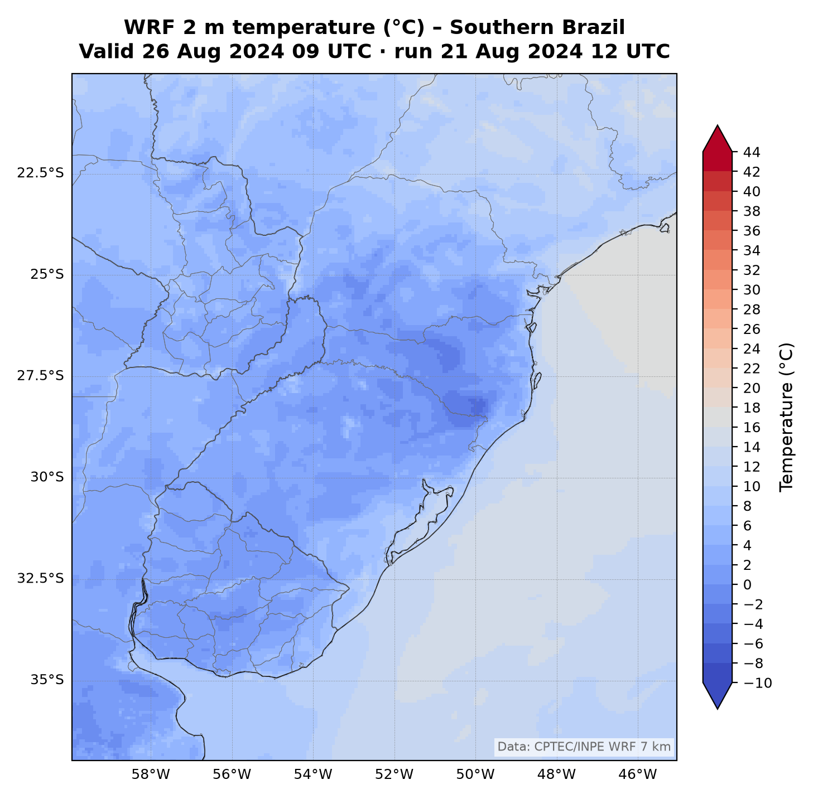

# WRF

**Turn CPTEC/INPE WRF regional model GRIB2 output into clean 2 m temperature maps of southern Brazil, with one Python command.**

[](https://github.com/valkiriaandrade/WRF/actions/workflows/tests.yml)

[](LICENSE)

## Gallery



*WRF 7 km 2 m temperature over southern Brazil, valid 26 Aug 2024 09 UTC (06h local time),
from the 21 Aug 2024 12 UTC run: a cold early morning, with temperatures near or below
0 °C on the Santa Catarina highlands.*

## What it does

- Reads the **2 m temperature** field from a WRF GRIB2 file with ecCodes (exactly one field
  per file; ambiguous or non-kelvin fields are rejected).
- Converts kelvin to °C and draws a map of the model domain or of the southern states
  (PR, SC, RS), with coastline, country and state borders, lat/lon labels, units and a
  source credit.
- Builds the title from the data: valid time (UTC) and, for CPTEC file names, the model run.

## Data source

[**WRF**](https://www.mmm.ucar.edu/models/wrf) (Weather Research and Forecasting model) is a
limited-area numerical weather prediction model. [CPTEC/INPE](https://www.cptec.inpe.br/) runs
it operationally over South America and distributes GRIB2 output; the sample file is the
**7 km southern Brazil (SU) domain**:

| File | Content |
|---|---|
| `data/WRF_cpt_07KM_SU_2024082112_2024082609.grib2` | Run 21 Aug 2024 12 UTC, valid 26 Aug 2024 09 UTC (243 × 214 grid) |

The provider name encodes `WRF_cpt_<resolution>_<domain>_<run YYYYMMDDHH>_<valid YYYYMMDDHH>`.

## Install

Python 3.10 or later. GRIB2 is read with [ecCodes](https://github.com/ecmwf/eccodes-python),
which installs from pip with its binaries on Windows, Linux and macOS.

```bash
git clone https://github.com/valkiriaandrade/WRF.git
cd WRF
python -m venv .venv
source .venv/bin/activate          # Windows PowerShell: .venv\Scripts\Activate.ps1
python -m pip install -e ".[dev]"  # or: make install
```

## Quick start

```bash
# Whole model domain
wrf-maps --input data/WRF_cpt_07KM_SU_2024082112_2024082609.grib2 --output output/t2m.png

# Zoom on PR, SC and RS, at 300 dpi
wrf-maps --input data/WRF_cpt_07KM_SU_2024082112_2024082609.grib2 \
         --region south --dpi 300 --output output/t2m_south.png

# Rebuild every figure in figures/
make figures                       # or: python scripts/make_figures.py
```

## CLI options

`wrf-maps --help` prints the full list.

| Option | Default | Description |
|---|---|---|
| `--input FILE` | *required* | GRIB2 file with exactly one 2 m temperature field |
| `--output FILE` | *required* | Output PNG (folders are created) |
| `--region {domain,south}` | `domain` | Whole model grid, or PR/SC/RS; the Portuguese alias `sul` is also accepted |
| `--shapefile FILE` | – | State boundaries with a CRS (`.shp` or zipped) to mask the field; by default Natural Earth borders are drawn |
| `--title TEXT` | built from the data | Custom map title |
| `--dpi N` | `200` | PNG resolution |
| `--verbose` | off | Debug logging and full tracebacks |

`scripts/wrf_2m_temperature.py` is a shortcut for the same command.

## Project structure

```
WRF/
├── data/                  # sample CPTEC WRF GRIB2 file
├── figures/               # published maps (rebuilt with `make figures`)
├── scripts/
│   ├── make_figures.py    # regenerates every figure in figures/
│   └── wrf_2m_temperature.py
├── src/wrf_maps/
│   ├── cli.py             # command-line interface
│   ├── io.py              # GRIB2 reading with ecCodes
│   ├── plotting.py        # shared map style and rendering
│   ├── labels.py          # K → °C, titles and run metadata
│   └── regions.py         # map domains and region aliases
├── tests/                 # pytest suite (synthetic data + the real GRIB2 file)
├── docs/                  # validation notes and project history
├── Makefile
└── pyproject.toml
```

## Development

```bash
make install   # editable install with dev tools + pre-commit hooks (ruff)
make test      # pytest with coverage report
make lint      # ruff check + ruff format --check
make figures   # regenerate every figure in figures/ from data/
```

On Windows without `make`, run the commands from the [Makefile](Makefile) directly, e.g.
`python -m pytest -q --cov` or `python scripts/make_figures.py`. The first map run without a
shapefile downloads Natural Earth borders (cached afterwards).

## License

[MIT](LICENSE) © Valkiria Andrade.

---

Project history: [original README](docs/README-original.md).
